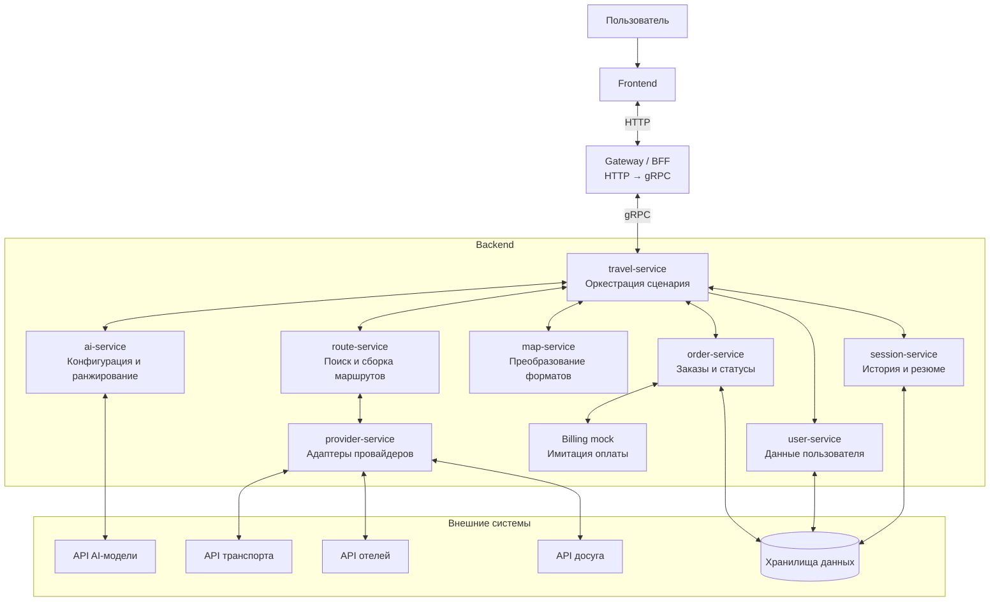
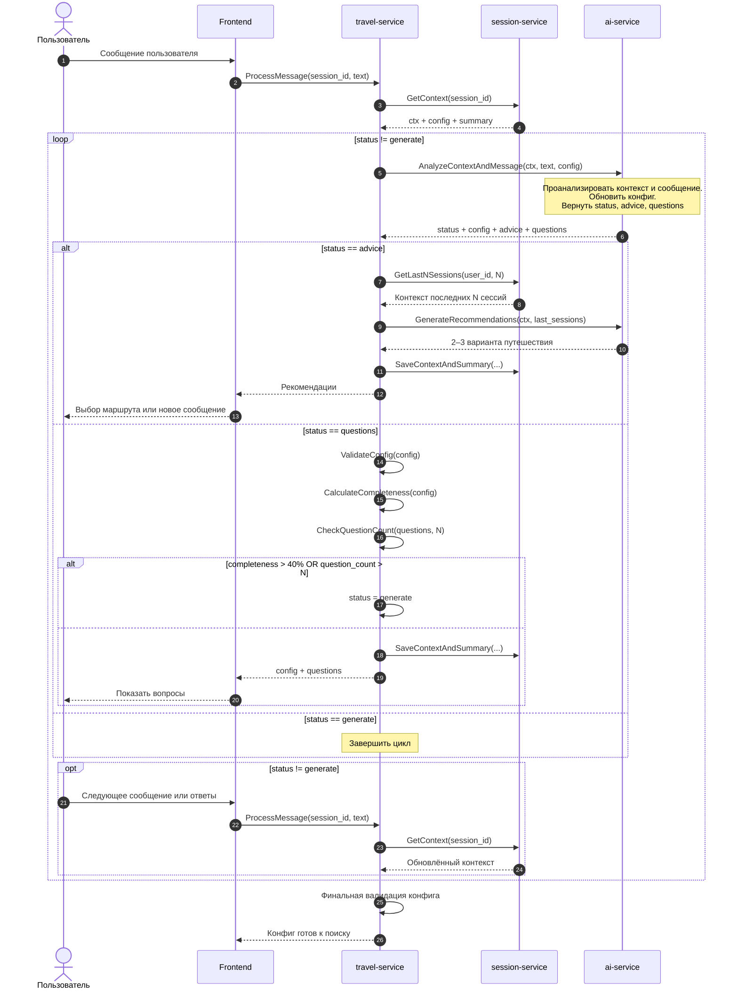
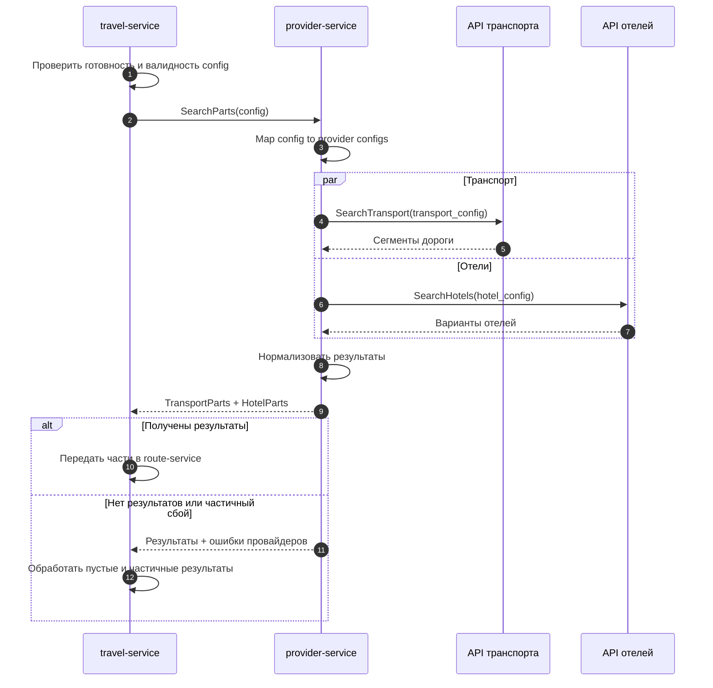
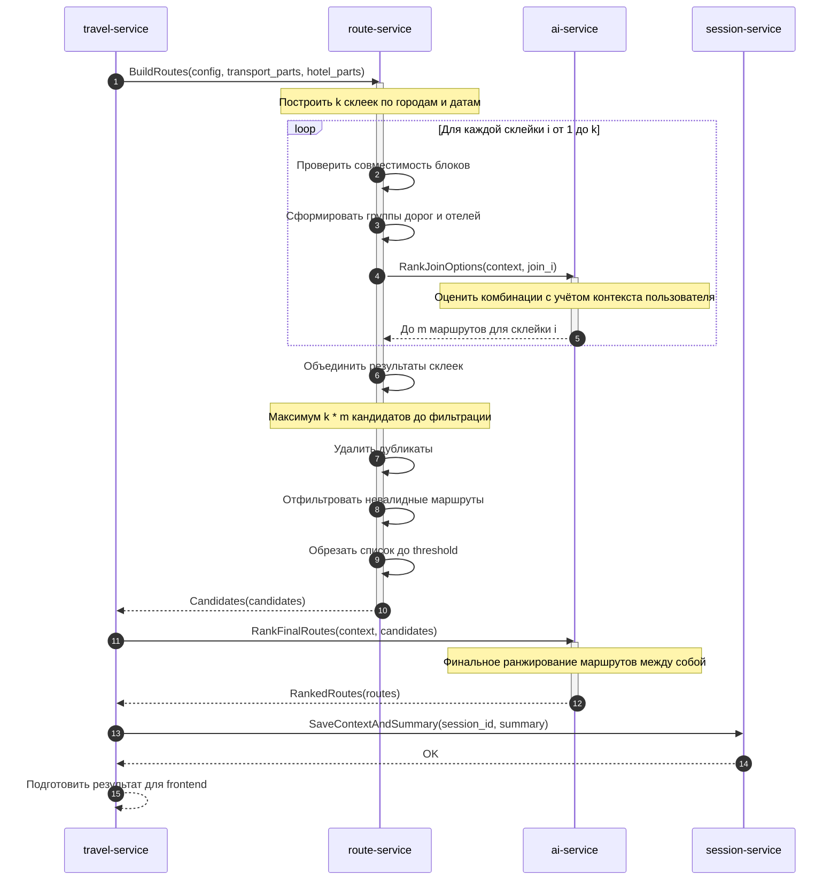
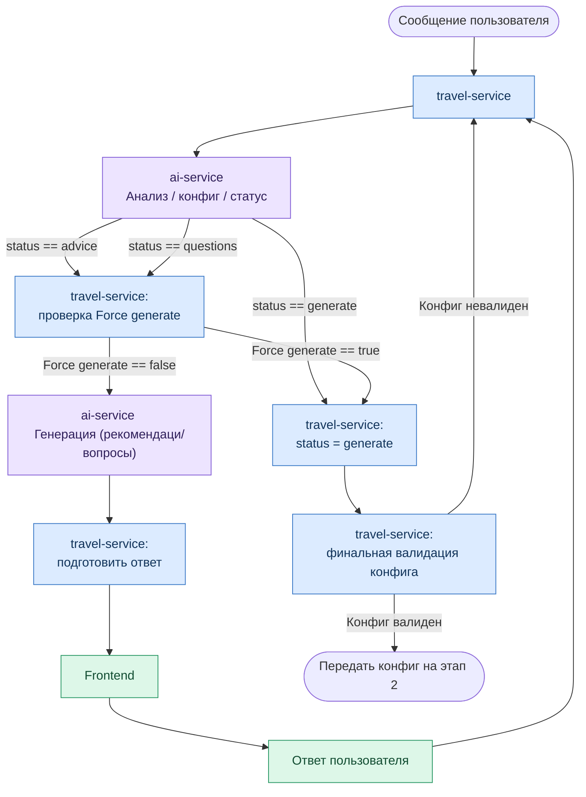
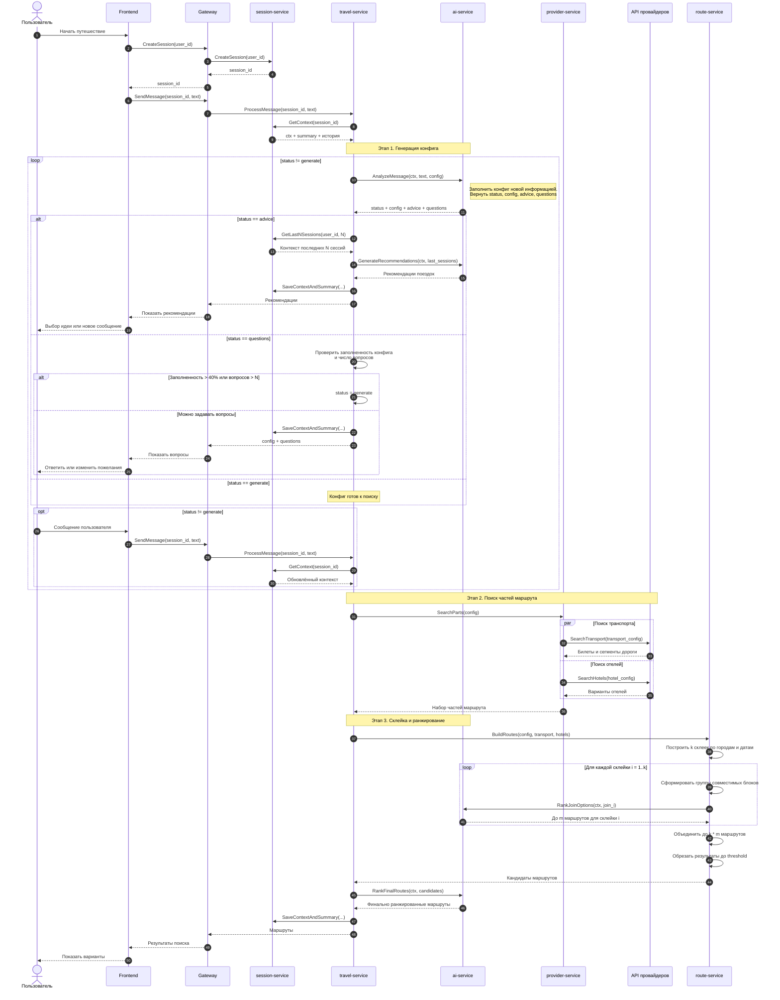
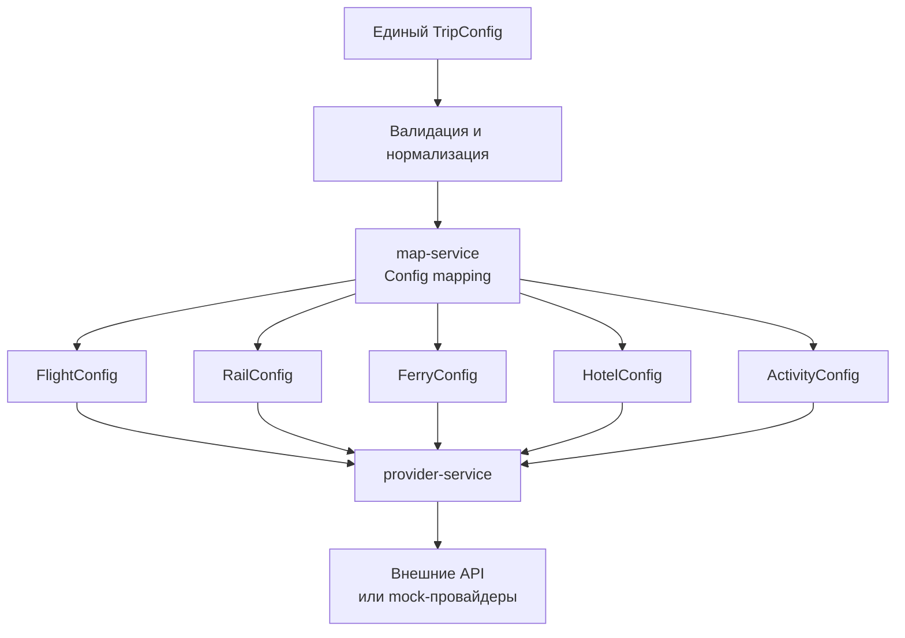
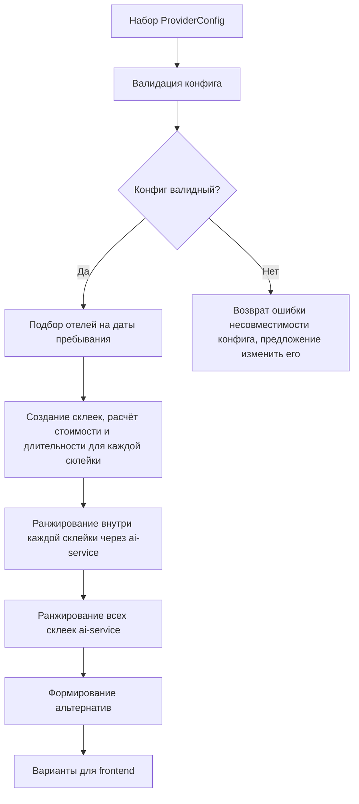

# Travel AI Agent

Ниже подробное тз, созданное совместно с chat gpt. 
Основные ссылки, необходимые для работы, представлены в пункте [Кратко](#кратко)

## Кратко:

- [1. Архитектура системы](#1-архитектура-системы)
- [2. Этапы обработки запроса](#2-этапы-обработки-запроса)
- [3. Взаимодействие микросервисов](#3-взаимодействие-микросервисов)


---

## 1. Архитектура системы

Система состоит из frontend, HTTP gateway и backend-микросервисов, взаимодействующих по gRPC.

Frontend общается только с gateway. Gateway реализует паттерн BFF (Backend for Frontend), преобразуя HTTP-запросы клиента в соответствующие gRPC-вызовы.

### Общий поток данных

1. `session-service` создаёт сессию и сохраняет историю взаимодействия.
2. `travel-service` принимает пользовательский запрос и управляет сценарием планирования.
3. `ai-service` формирует и обновляет конфигурацию, задаёт уточняющие вопросы и ранжирует результаты.
4. `map-service` преобразует единую конфигурацию в форматы запросов конкретных провайдеров, а результаты маршрутов — в формат для frontend.
5. `route-service` вызывает провайдеров, получает предложения и формирует согласованные варианты поездок.
6. `order-service` сохраняет выбранный маршрут и управляет статусом заказа.
7. `user-service` предоставляет персональные данные пользователя.

### Mermaid: архитектура верхнего уровня



---

## 2. Этапы обработки запроса.

__Этап 1 : Генерация конфига__:\
`travel-service` ведёт цикл обработки сообщений пользователя, пока `ai-service` не вернёт статус `generate`. Статусы `advice` и `questions` обрабатываются внутри цикла.



Пример ответа ai-service:

```json
{
  "status": "questions",
  "config": {},
  "advice": [],
  "questions": [
    {
      "id": "trip_dates",
      "field": "trip.date_range",
      "text": "Когда планируете поездку?",
      "required": true
    }
  ]
}
```

Допустимые значения status:
Статус	| Поведение
advice	| Сгенерировать рекомендации с учётом контекста
questions	| Проверить конфиг и решить, задавать ли уточнения
generate	| Перейти к поиску частей маршрута


__Note:__\
Условие `question_count` > `N` буквально означает, что при большом количестве вопросов система прекращает уточнения. Сделано для защиты от большого кол-ва вопросов.

Перед поиском __обязательно__ нужно заполнить обязательные поля маршрута. Если пользователь их не ввел, просим `ai-service` их ввести, исходя из контекста.

__Этап 2 : Поиск частей маршрута__:\
`provider-service` получает единый конфиг, обращается к API транспорта и отелей и возвращает отдельные предложения.




__Этап 3 : Склейка и ранжирование__:\
`route-service` формирует k склеек, для каждой получает до m вариантов от `ai-service`, после чего `travel-service` запускает финальное ранжирование всех склеек, ограничивает общее число результатов порогом _threshold_.

В диаграммах ниже status используется как результат обработки сообщения, а threshold и n - настраиваемые параметры. Условие заполненность > 40% проверяется в travel-service, независимо от ответа AI.




Основной пользовательский сценарий представлен ниже. Два первоначальных пути — пользователь знает, чего хочет, или просит придумать путешествие — сходятся на этапе уточнения параметров и подтверждения конфигурации.



---

## 3. Взаимодействие микросервисов

### Диаграмма последовательности: от запроса до маршрутов



### Основные правила взаимодействия

- Между frontend и gateway используется HTTP/JSON.
- Между backend-сервисами используется gRPC и protobuf-контракты.
- Внешние API вызываются через адаптеры провайдеров, чтобы изолировать различия в форматах запросов и ответов.
- `travel-service` является оркестратором: он не должен самостоятельно реализовывать интеграции каждого провайдера.
- `route-service` отвечает за совместимость компонентов маршрута, а `ai-service` — за семантическую оценку и ранжирование.
- Длительные операции должны поддерживать тайм-ауты, отмену запросов и частичные ошибки.

---

## 5. Сервисы и их ответственность

| Сервис | Ответственность | Основные операции |
|---|---|---|
| `gateway` | BFF, преобразование HTTP в gRPC | HTTP endpoints, авторизация, маршрутизация запросов |
| `travel-service` | Оркестрация сценария путешествия | Создание и обновление конфига, запуск поиска, выбор маршрута |
| `ai-service` | Работа с API AI-модели | Заполнение конфига, уточнения, генерация идей, ранжирование |
| `provider-service` | Адаптеры внешних API | Поиск билетов, отелей, досуга, нормализация результатов |
| `route-service` | Поиск и сборка маршрутов | Параллельный поиск, проверка стыковок, формирование вариантов |
| `map-service` | Преобразование форматов данных | Конфиг поездки → конфиги провайдеров; маршрут → DTO frontend |
| `session-service` | Контекст диалога | Создание сессий, хранение истории и резюме |
| `user-service` | Данные пользователя | Получение и обновление персональных настроек |
| `order-service` | Жизненный цикл заказа | Создание, хранение, оплата, отмена |
| Billing mock | Имитация платёжной системы | Тестовая оплата и результат транзакции |
<!-- 
### 5.1. `travel-service`

Главный координатор бизнес-процесса.

Функции:

- Получает пользовательский запрос.
- Загружает историю и резюме сессии.
- Передаёт запрос и контекст в `ai-service`.
- Проверяет полноту и корректность конфигурации.
- Возвращает пользователю уточняющие вопросы.
- Запускает поиск только после подтверждения конфигурации.
- Запрашивает преобразование конфигурации для провайдеров.
- Передаёт конфиги в `route-service`.
- Запрашивает ранжирование результатов.
- Обрабатывает изменение пожеланий и повторный поиск.
- Инициирует создание заказа после выбора маршрута.

`travel-service` не должен доверять конфигу от модели без проверки типов, диапазонов и обязательных полей.

### 5.2. `ai-service`

Инкапсулирует интеграцию с API AI-агента.

Основные задачи:

1. Извлечение параметров путешествия из естественного языка.
2. Заполнение единого JSON-конфига.
3. Определение намерения пользователя: спланировать поездку или получить идеи.
4. Генерация уточняющих вопросов.
5. Обновление конфигурации с учётом ответов и правок.
6. Создание 2–3 различных идей путешествия, если пользователь не определился.
7. Ранжирование уже найденных маршрутов и объяснение оценок.

AI-модель не должна придумывать подтверждённые цены, билеты или доступность отелей. Эти данные поступают из провайдеров.

### 5.3. `provider-service`

Содержит адаптеры к внешним поставщикам данных:

- авиационные билеты;
- железнодорожные билеты;
- паромы и другие виды транспорта;
- отели;
- музеи, мероприятия и другие активности.

Каждый адаптер преобразует внутренний конфиг в формат внешнего API и нормализует ответ в общую модель предложения.

Для MVP допускаются mock-провайдеры с явно обозначенными тестовыми данными.

### 5.4. `route-service`

Получает набор конфигов провайдеров, выполняет поиск и строит осмысленные маршруты.

Функции:

- Параллельный вызов подходящих провайдеров.
- Нормализация результатов.
- Проверка соответствия датам, бюджету и другим ограничениям.
- Сопоставление времени прибытия и отправления.
- Поиск подходящих отелей на период между перемещениями.
- Расчёт длительности ожиданий и пересадок.
- Формирование нескольких альтернативных маршрутов.
- Возврат информации о несовместимых предложениях и причинах исключения.

### 5.5. `map-service`

Сервис преобразования моделей данных. В проекте у него две логически разные функции:

1. **Config mapping:** преобразование единого конфига путешествия в набор конфигов для конкретных провайдеров.
2. **Response mapping:** преобразование найденных маршрутов в формат, удобный для frontend.

Для MVP эти функции могут находиться в одном сервисе, но их следует реализовать как отдельные операции и модули. При дальнейшем развитии config mapping можно выделить в отдельный `config-mapper-service`.

### 5.6. `session-service`

Создаёт и хранит сессии пользователя.

Пример модели сессии:

- `session_id` — уникальный идентификатор;
- `user_id` — владелец сессии;
- `messages` — история диалога;
- `summary` — краткое резюме контекста;
- `trip_config` — текущая конфигурация путешествия;
- `status` — состояние пользовательского сценария;
- `created_at`, `updated_at` — даты создания и изменения.

`session-service` должен предоставлять как минимум операции создания сессии, получения контекста и сохранения новых сообщений и резюме.

### 5.7. `user-service`

Отвечает за профиль пользователя и его настройки: предпочтения, язык, валюту и другие данные, необходимые для персонализации.

Персональные данные не следует передавать в AI-модель, если они не нужны для конкретной операции.

### 5.8. `order-service`

Хранит заказы, выбранные маршруты и статусы их обработки.

Сервис должен обеспечивать идемпотентность операций бронирования, оплаты и отмены, чтобы повторный запрос не создавал дублирующий заказ или платёж.

---

## 6. Сценарии работы AI-агента

### Сценарий A. Пользователь знает, чего хочет

Пример запроса:

> Хочу провести пять дней в Италии в ноябре, вылет из Берлина, бюджет до 1200 евро, люблю музеи и небольшие города.

Последовательность:

1. `travel-service` загружает контекст сессии.
2. Передаёт запрос и существующий конфиг в `ai-service`.
3. AI заполняет все параметры, которые можно извлечь из запроса.
4. AI возвращает частично заполненный конфиг и список уточняющих вопросов.
5. Пользователь отвечает на вопросы.
6. Ответы передаются одной упорядоченной коллекцией, связанной с соответствующими вопросами.
7. AI обновляет конфиг, учитывая историю и последние ответы.
8. Backend проверяет обязательные поля.
9. Если обязательных параметров не хватает, задаются дополнительные вопросы.
10. Когда конфиг валиден, frontend отображает его пользователю.
11. Пользователь вносит правки или подтверждает параметры.
12. После подтверждения запускается поиск маршрутов.

**Требование к frontend:** каждый вопрос должен отображаться в отдельном редактируемом поле или окне. Пользователь должен иметь возможность вернуться к предыдущему вопросу и изменить ответ. При отправке на backend все вопросы и ответы передаются одним пакетом в исходном порядке. Backend должен сохранять идентификатор вопроса или другой стабильный ключ, чтобы сопоставление не зависело только от текста.

### Сценарий B. Пользователь не знает, куда хочет поехать

Пример запроса:

> Хочу недорогой отпуск на пять дней. Не знаю, куда поехать — придумай что-нибудь интересное.

Последовательность:

1. `travel-service` отправляет запрос в `ai-service`.
2. AI определяет, что пользователь просит рекомендации.
3. AI возвращает 2–3 существенно различающиеся идеи путешествия.
4. Frontend показывает варианты с описанием направления, примерной продолжительности, интересных мест и предполагаемого бюджета.
5. Пользователь выбирает вариант и оставляет комментарий.
6. `travel-service` передаёт выбранную идею и комментарий в `ai-service`.
7. AI формирует конфигурацию выбранного направления и список уточняющих вопросов.
8. Далее процесс совпадает со сценарием A: уточнения, валидация, подтверждение и поиск реальных предложений.

До получения результатов от провайдеров предполагаемые цены и доступность должны быть обозначены как ориентировочные, а не подтверждённые.

### Сценарий C. Изменение уже найденного маршрута

Пример:

> Замени отель на более дешёвый и добавь ещё один день в Риме.

Последовательность:

1. Backend загружает текущий конфиг и выбранный маршрут.
2. `ai-service` интерпретирует правку и обновляет соответствующие поля конфига.
3. Backend валидирует изменения.
4. Если необходимы уточнения, система задаёт вопросы.
5. После подтверждения повторно запрашиваются только те данные, которые затронуты изменениями, если это позволяет реализация.
6. `route-service` формирует обновлённые варианты маршрута.
7. Frontend показывает изменения относительно предыдущего результата.

Если изменение дат делает прежние предложения неактуальными, система должна перепроверить их доступность и стоимость.

--- -->

## Конфигурация путешествия

Система использует два уровня конфигурации:

1. **Единый конфиг путешествия** — основная модель, которую заполняет и обновляет AI.
2. **Конфиги провайдеров** — отдельные структуры, сформированные из единого конфига для запросов к конкретным API.

Единый конфиг хранит пользовательские требования и ограничения. Он не должен содержать детали реализации каждого внешнего API.

### 1. Пример единого конфига

to do : сделать после получения api провайдеров

```json
{
  "version": "1.0",
  "trip": [
    {
      "type": "road",
      "start_date": [],
      "end_date": [],
      "city_from": [],
      "city_to": [],
      ...
    },
    {
      "type": "Point of stay",
      "name(city name)": [],
      "start_date": [],
      "end_date": [],
      ...
    }
    ...
  ]
}
```

### Обязательные и необязательные поля

К обязательным для запуска поиска можно отнести:

Набор required-полей должен быть минимальным.
Если в значении поля массив из нескольких значений, то берется одно значение на выбор.


Если при генерации набор полей обязательных неполный, оправляется запрос в ai-service с заполнением полей исходя из контекста пользователя.


## 6. Преобразование конфигураций для провайдеров

### 6.1. Общая схема

Единый конфиг не отправляется напрямую во все внешние API. Вместо этого `map-service` преобразует его в набор отдельных конфигов.



###  Конфиги отдельных провайдеров

Для каждого типа API используется отдельная структура:

- `FlightConfig` — города и аэропорты, даты, пассажиры, класс обслуживания, багаж.
- `RailConfig` — станции, даты, пассажиры, допустимые пересадки.
- `FerryConfig` — порты, даты, пассажиры и дополнительные параметры перевозки.
- `HotelConfig` — город или район, даты заезда и выезда, гости, номера, категория, бюджет.
- `ActivityConfig` — город, дата и время, количество посетителей, возрастные категории, тип активности.

Для разных API одной категории могут потребоваться разные поля. Поэтому полезно разделять внутреннюю нормализованную модель запроса и конкретный DTO внешнего провайдера.

### 6.3. Пример `HotelConfig`

```json
{
  "provider": "example-hotel-provider",
  "city": "Rome",
  "check_in": "2026-11-10",
  "check_out": "2026-11-15",
  "adults": 2,
  "children_ages": [],
  "min_stars": 3,
  "max_price_per_night": 150,
  "currency": "EUR"
}
```

### 6.4. Правила преобразования

- Даты передаются в согласованном формате; часовой пояс задаётся явно там, где важны время и расписание.
- Валюта должна быть указана явно.
- Единицы измерения нормализуются до передачи в провайдер.
- Неизвестные обязательные поля не подменяются случайными значениями.
- Неизвестные необязательные поля опускаются либо передаются как `null`, если этого требует контракт.
- Параметры, которые провайдер не поддерживает, обрабатываются явно: фильтруются после ответа или приводят к уточнению.
- Ответы провайдеров нормализуются в общие модели транспорта, отеля и активности.
- Для каждого предложения сохраняется источник, время получения и доступные сведения о цене и условиях.

### 6.5. Реализация в Go

Конфиги удобно хранить как типизированные структуры, а реестры провайдеров — как мапу адаптеров или конфигураций.

```go
type ProviderConfig interface {
    ProviderName() string
}

type FlightConfig struct {
    Origin      string
    Destination string
    Departure   string
    Return      string
    Adults      int
    Currency    string
}

type HotelConfig struct {
    City             string
    CheckIn          string
    CheckOut         string
    Adults           int
    MinStars         *int
    MaxPricePerNight *float64
    Currency         string
}

type ProviderRegistry struct {
    FlightProviders map[string]FlightConfig
    HotelProviders  map[string]HotelConfig
}
```

Это лишь пример внутреннего представления. В реальном коде стоит использовать `time.Time` для дат и отдельные типы для денег, валют, идентификаторов и диапазонов.

Конфигурационные файлы провайдеров должны описывать настройки интеграции: базовый URL, поддерживаемые возможности, лимиты, тайм-ауты и параметры авторизации. Секреты и API-ключи следует хранить в переменных окружения или секрет-хранилище, а не в JSON-файлах, попадающих в репозиторий.

---

## 7. Маршруты

### 7.1. Mermaid: сборка вариантов маршрута



### 7.2. Что считать осмысленным маршрутом

Маршрут должен содержать:

- упорядоченные сегменты транспорта;
- время отправления и прибытия;
- пересадки и время ожидания;
- даты заезда и выезда из отеля;
- активности с датами и временем, если они выбраны;
- стоимость каждого компонента и итоговую стоимость;
- валюту и сведения о том, какие расходы включены;
- ограничения и предупреждения;
- источник данных и время последней проверки.

Если подходящих стыковок нет, сервис должен вернуть понятный результат: например, отсутствие маршрута на заданные даты или необходимость изменить даты, бюджет либо ограничения. Не следует формировать заведомо невозможный маршрут только ради выдачи нескольких вариантов.

### 7.3. Ранжирование

2 этапа ранжирования:

1. Ранжирование вариантов внутри каждой склейки:

* каждый маршрут состоит из блоков - `дорога | отель | дорога | отель | ... |отель | дорога`
* собирается __n__ склеек блоков по всем точкам, склейки создаются по дате + городу (для каждой дороги в город __M__ с прибытием в дату __n__, ищется отель в городе __M__ с датой заселения не позже даты __n__)
* внутри каждой склейки создается группа дорог из точки __A__ в точку __B__ с отъездом в дату __a__, приездом в дату __b__, группа отелей в городе __A__ с заселением не позже даты __a__ и тд
* для каждой склейки происходит ранжирование внутри блока, определение наилучшего -> из него создается 1 маршрут
* для каждой склейки создается __m__ маршрутов
* ожидается __k * m__ маршрутов (для каждой из k склеек создается m маршрутов)

2. Ранжирование всех маршрутов (всех склеек):

* все k * m маршрутов снова ранжируются
* берется топ `threshold` маршрутов


<!-- 
---

## 10. Бронирование, оплата и отмена

### 10.1. Жизненный цикл заказа

В MVP предлагается следующий набор статусов:

- `booked` — заказ создан и бронирование зафиксировано в рамках реализованной модели;
- `paid` — оплата успешно подтверждена;
- `cancelled` — заказ отменён.

При необходимости позднее можно добавить `pending`, `failed`, `expired` и `refund_pending`.

### Mermaid: жизненный цикл заказа


### 10.2. Бронирование -->
<!-- 
1. Пользователь выбирает вариант маршрута.
2. Frontend передаёт идентификатор варианта в gateway.
3. `travel-service` инициирует создание заказа.
4. `order-service` сохраняет состав маршрута, стоимость, валюту, пользователя и статус.
5. Frontend получает идентификатор заказа и его статус.

Если внешние провайдеры поддерживают реальные бронирования, необходимо отдельно реализовать резервирование каждого компонента, обработку частичного успеха и компенсацию уже выполненных операций. Само сохранение маршрута в БД не гарантирует, что билеты и номера действительно забронированы.

### 10.3. Оплата

Для демонстрации используется mock billing service.

1. Клиент инициирует оплату заказа.
2. `order-service` проверяет текущий статус и сумму.
3. Вызывается имитированный платёжный сервис.
4. При успешном ответе заказ переводится в `paid`.
5. При ошибке заказа сохраняется согласованный статус ошибки, а повторная оплата выполняется идемпотентно.

### 10.4. Отмена

Отмена разрешается, если до начала маршрута остаётся больше заданного порога времени и правила заказа допускают отмену.

Порог должен быть конфигурируемым, например `CANCEL_CUTOFF_HOURS`

При отмене нужно:

- проверить владельца заказа;
- проверить текущий статус;
- проверить время до начала поездки;
- проверить ограничения провайдера;
- выполнить отмену компонентов, если они реально бронировались;
- сохранить итоговый статус и причину отмены.

Для оплаченного заказа отмена и возврат денег — разные операции. В MVP их можно имитировать, но в модели данных их желательно не смешивать.

--- -->

## 8. Хранение сессий и контекста

Сессия нужна для хранения контекста диалога + конфига.
Перед обработкой запроса `travel-service` всегда ходит за контекстом и текущим конфигом пользователя (кроме обработки запроса `Start New session`)

### Рекомендуемая модель

```json
{
  "session_id": "session-uuid",
  "user_id": "user-123",
  "status": "collecting_preferences",
  "messages": [],
  "summary": "Пользователь планирует поездку в Италию на пять дней.",
  "trip_config": {},
  "created_at": "2026-10-25T12:00:00Z",
  "updated_at": "2026-10-25T12:05:00Z"
}
```

`session_id` должен быть уникальным и непредсказуемым. В каждом запросе backend проверяет, имеет ли пользователь право обращаться к данной сессии.

### Принципы хранения

- История диалога хранится отдельно от структурированного конфига.
- Резюме используется для сокращения контекста, передаваемого модели.
- Последний валидный конфиг сохраняется после каждого значимого изменения.
- Ответы пользователя связываются с вопросами стабильными идентификаторами.
- Смена дат или направления помечает потенциально устаревшие результаты поиска.
- Создание заказа сохраняет снимок выбранного маршрута, чтобы дальнейшие изменения сессии не изменяли заказ задним числом.


---

## 9. Контракт frontend <-> backend

Frontend не должен обращаться к микросервисам напрямую. Все пользовательские запросы проходят через gateway.

Рекомендуемые HTTP endpoints:

| Метод | Endpoint | Назначение |
|---|---|---|
| `POST` | `/api/sessions` | Создать сессию |
| `GET` | `/api/sessions/{session_id}` | Получить состояние сессии |
| `POST` | `/api/sessions/{session_id}/messages` | Отправить сообщение |
| `POST` | `/api/sessions/{session_id}/answers` | Передать ответы на вопросы |
| `GET` | `/api/sessions/{session_id}/config` | Получить текущую конфигурацию |
| `PATCH` | `/api/sessions/{session_id}/config` | Изменить поля конфигурации |
| `POST` | `/api/sessions/{session_id}/confirm` | Подтвердить конфигурацию |
| `POST` | `/api/sessions/{session_id}/search` | Запустить поиск маршрутов |
| `GET` | `/api/sessions/{session_id}/routes` | Получить варианты маршрутов |
| `POST` | `/api/orders` | Создать заказ из выбранного маршрута |
| `POST` | `/api/orders/{order_id}/pay` | Инициировать оплату |
| `POST` | `/api/orders/{order_id}/cancel` | Отменить заказ |


### Важные требования к frontend

- Каждый уточняющий вопрос имеет собственное редактируемое поле.
- Пользователь может вернуться к предыдущему вопросу и изменить ответ.
- Ответы передаются массивом в том же порядке, в котором были заданы вопросы; предпочтительно также передавать `question_id`.
- Конфиг показывается пользователю в редактируемой форме до запуска поиска.
- Изменение отдельного поля отправляется как структурированное обновление, а не как произвольный текст.
- Текстовые правки передаются через `ai-service`.
- После подтверждения отображается состояние поиска и результат: найденные маршруты, частичные результаты либо понятная ошибка.
- Перед бронированием показывается актуальная цена и состав выбранного маршрута.

---

## 10. Обработка ошибок и ограничения

Система должна предусматривать следующие случаи:

- AI не вернул валидный JSON.
- Конфиг содержит недопустимые значения.
- Не заполнено обязательное поле.
- Внешний API не отвечает или превышен тайм-аут.
- Один провайдер недоступен, но другие вернули результаты.
- Предложения не стыкуются по времени.
- Цена или доступность изменились между поиском и бронированием.
- Пользователь повторно отправил один запрос.
- Заказ уже оплачен или отменён.
- Пользователь пытается обратиться к чужой сессии или заказу.

### Рекомендуемые меры

- Валидировать конфиг и ответы AI по схеме.
- Использовать тайм-ауты и ограниченные повторы для внешних запросов.
- Применять идемпотентные ключи для создания заказа и оплаты.
- Сохранять исходные ответы провайдеров либо нормализованные снимки предложений.
- Возвращать частичные результаты, если это допустимо и явно обозначено.
- Не позволять модели самостоятельно менять статусы заказов или обходить бизнес-ограничения.
- Логировать `request_id`, `session_id` и `order_id`, не записывая секреты и лишние персональные данные.
- Проверять права доступа на уровне backend, а не только frontend.

---

## 11. План реализации

### Этап 1. Базовая инфраструктура

- [ ] Определить protobuf-контракты.
- [ ] Реализовать gateway и gRPC-соединения.
- [ ] Реализовать создание сессий и хранение контекста.
- [ ] Утвердить JSON Schema единого конфига.
- [ ] Реализовать валидацию конфигурации.

### Этап 2. AI-планирование

- [ ] Реализовать заполнение конфига по тексту.
- [ ] Реализовать структурированные уточняющие вопросы.
- [ ] Реализовать обновление конфига по ответам и правкам.
- [ ] Реализовать сценарий генерации идей.
- [ ] Добавить проверку JSON-ответов модели.

### Этап 3. Поиск маршрутов

- [ ] Реализовать config mapping.
- [ ] Реализовать mock-провайдеры транспорта и отелей.
- [ ] Реализовать параллельный поиск.
- [ ] Реализовать нормализацию результатов.
- [ ] Реализовать проверку дат, пересадок и длительности ожидания.
- [ ] Сформировать несколько альтернативных маршрутов.
- [ ] Реализовать ранжирование и объяснения.

### Этап 4. Frontend и итерации

- [ ] Реализовать отдельные редактируемые поля для вопросов.
- [ ] Реализовать форму изменения JSON-конфига.
- [ ] Реализовать сравнение вариантов маршрутов.
- [ ] Реализовать изменение пожеланий и повторный поиск.
- [ ] Реализовать отображение ошибок и частичных результатов.

### Этап 5. Заказы

- [ ] Реализовать сохранение выбранного маршрута.
- [ ] Реализовать статусы заказа.
- [ ] Реализовать mock billing service.
- [ ] Реализовать идемпотентную оплату.
- [ ] Реализовать отмену по временному ограничению.
- [ ] Добавить тесты на повторные запросы и недопустимые переходы статусов.

### Критерии готовности MVP

MVP можно считать готовым, когда пользователь способен начать с произвольного текстового запроса, получить и подтвердить валидную конфигурацию, найти несколько согласованных вариантов маршрута, изменить пожелания, повторно получить результаты и пройти имитированный процесс бронирования, оплаты и отмены без потери контекста.


## Промпты:
__1. текст по результатам встречи + промпт для генерации ABOUT.md:__
напиши описание проекта исходя из тз и информации ниже. Добавь mermaid-диаграммы для сценария, взаимодействия сервисов. краткое описание:

1.backend (grpc):
travel-service:- модерирует работу (заполнение конфига через ai-сервис, поиск маршрутов через provider-service, ранжирование через ai-service)

ai-service:
* ходит в api агента (заполнение конфига, ранжирование)


provider-service:
* по конфигу собирает путешествия (дорога + отели), ходит в api провайдера (провайдер - поставщик билетов/бронирований отелей)


user-service:
* перс данные

session-service:
* история клиента : ходит в репозитории с хранением сессии (история чата; резюме)
* создает новые сессии (ручка create new session (user id))

map-service:
* маппит данные о маршруте в нужный формат для предоставления на фронте
про конфигурационный файл:
конфигурационные json-файлы для провайдеров путешествий (билеты - авиа, ж/д, корабль и тд; отели; досуг (музеи, кинотеатры), если есть ограничения на формат, указать (длина слов, диапазон значений, формат предствления дат и тд)
• файл для заполнения ai-агентом (все параметры в одном конфиге, заполняется через travel-service и ai-service)
• конфиг для каждого api (нужно для того, чтобы передавать его в запросы к отдельным провайдерам) (в коде будет реализовано как мапа [имя провайдера]config, чтобы дальше передавать в http-запрос) - заполняется из полей для файла для заполнения ai-агентом 

задача сервиса - перемаппить файл для заполнения ai-агентом в файлы для каждого сервиса

Route-service:
- принимает запросы для сервисов-провайдеров (перемапленные)
- отправляет запросы в сервисы провайдеры
- собирает осмысленный маршрут из ответа сервисов (ищет состыковки в датах, если есть окна, указывает их и тд) - составляет несколько вариантов маршрутов


Order service:
- Хранение заказов
(Статусы заказов : бронь, оплачен)


gateway:
реализует паттерн BFF (принимает http-запросы с фронтенда, отправляет grpc-запросы в бэкенд)


fronted: 
отправляет запросы в gateway


__2. Промпт с описанием этапов:__

этап 1. генерация конфига

сделай цикл while (status != generate), в котором вместо "Описание поездки", операция "Сообщение пользователя". Далее сообщение отправляется в ai-service с запросом: "проанализируй контекст, новое сообщение пользователя, заполни конфиг новой информацией; верни доп поле advice, если пользователь просит совет, questions - если не хватает информации в конфиге (заполнено менее 40% полей; generate - если пользователь просит сгенерировать поездки или если информации в конфиге достаточно (более 40%)", в этом же цикле добавь if-else statement:
if status == advice - tarvel-service идет в ai-service с запросом генерации рекомендаций поездки (передает ctx, ctx последних n сессий), Travel-service возвращает полученную инфу на фронт
if status == questions - travel service проверяет доступность вопросов для пользователя - ручная проверка заполненности конфига и кол-во вопросов для текущего конфига (если заполненность > 40% || кол-во вопросов > n, то status -> generate и переход к след ветке), 
if status == generate - break while loop

этап 2. поиск частей маршрутов маршрутов
когда status == generate, travel-service отправляет запрос в provider-service, provider отправляет запрос в нужное api провайдеров путешествий (отели + билеты), ответ возвращается travel-service

этап 3. склейка и ранжирование маршрутов.
далее Travel-service отправляет запрос в route-service на склейку маршрутов. правила следующие:
* каждый маршрут состоит из блоков - дорога | отель | дорога | отель | ... |отель | дорога
* собирается n склеек блоков по всем точкам, склейки создаются по дате + городу (для каждой дороги в город M с прибытием в дату n, ищется отель в городе M с датой заселения не позже даты n)
* внутри каждой склейки создается группа дорог из точки A в точку B с отъездом в дату a, приездом в дату b, группа отелей в городе A с заселением не позже даты a и тд
* route-service отправляет запрос в ai-service для определения наилучших параметров каждой склейки, исходя из контекста пользователя; по результатам ответа сервиса ожидается m проранжированных составленных маршрутов
* действие происходит для каждой из k склеек. по итогу - наличие k * m склеенных маршрутов
* кол-во маршрутов обрезается до заданного threshold, маршруты передаются в Travel-service, далее передаются на frontend
* далее запрос в ai-service для ранжирования оставшихся маршрутов (производных от всех элементов склейки) 

обнови sequence-диаграмму. также сделай диаграммы состояний (взаимодействия сервисов для каждого этапа


<!-- 
описание шагов:
1. пользователь начинает сессию (session-service по user id генерирует новый session id)
2. пользователь пишет описание поездки


Этап 1: составление конфига
 
Далее идет запрос в ai-service в зависимости от ответа пользователя:
Travel-service отправляет запрос в ai-service. Зарос в ai-service единый, вида : « если в запросе есть описание поездки, заполни конфиг описанными параметрами; иначе - верни пустой конфиг. Если данных для конфига недостаточно (отсутствуют заполненные обязательные поля, много пустых не обязательных полей), задавай встречные вопросы о поездке. Если просьба посоветовать что-нибудь - составь 2-3 абсолютно разных маршрута, при составлении описания опирайся на набор полей из конфига (в дальнейшем тебе нужно будет его заполнить)»

I Сценарий: пользователь изначально знает, что хочет (пишет частичное описание поездки)
1. travel-service отправляет запрос в ai-service "проанализируй текст и заполни все возможные поля значениями из текста. если некоторые поля не заполнены, задай 2-3 встречных вопроса о поездке (в приоритет ставь заполнение полей, помеченных как required)…», ждет ответ вида (предзаполненный конфиг, []встречные вопросы) и пометку «пользователь знает, что хочет»
2. travel-service возвращает на frontend вопросы, пользователь на них отвечает
3. запрос в ai-service вида «ниже вопросы и ответы на вопросы, обнови конфиг», передавая ему контекст и вопросы с ответами. нижний вопрос имеет высший приоритет
(TO DO: отметь важным для frontend: на каждый вопрос должно быть свое окно, чтобы пользователь мог динамично изменять ответ во избежание случаев "а давай на прошлый вопрос ответим так», ответы и вопросы передаются сразу пачкой в том же порядке, в каком были переданы пользователю), сервис возвращает обновленный конфиг.
4. Если не все обязательные поля заполнены, задается вопрос на заполнение обязательных полей - ответы передаются в ai-service с запросом на обновление конфига
5. Если все обязательные поля заполнены, пользователю выводится отформатированное сообщение о конфигурации поездки: 1. Он пишет правки (правки текстом - обновление через ai-service, правки конфига (в ui сделать возможность менять значения параметра) - запрос на обновление json-конфига напрямую); 2. ОК - запускается поиск маршрута

II Сценарий: пользователь изначально не знает, что хочет (пишет ответ вида «вообще не знаю, придумай что-нибудь сам»)
Разница с I сценарии в ветке исходного промпта.
1. travel-service отправляет запрос в ai-service, ждет ответ вида (предзаполненный конфиг (пустой), []описание маршрутов и мест) и пометку «совет», отправляется в frontend-service
2. Пользователь нажимает на желаемый маршрут, пишет комментарий
3. Travel-service отправляет запрос в ai-service с промытом вида «Обнови данные маршрута исходя из контекста и ответа пользователя. Ответ ставь в приоритет, верни встречные вопросы». Ждет ответ вида (предзаполненный конфиг, []встречные вопросы) и пометку «пользователь знает, что хочет»
Далее аналогично сценарию 1:
4. Если не все обязательные поля заполнены, задается вопрос на заполнение обязательных полей - ответы передаются в ai-service с запросом на обновление конфига
5. Если все обязательные поля заполнены, пользователю выводится отформатированное сообщение о конфигурации поездки: 1. Он пишет правки (правки текстом - обновление через ai-service, правки конфига (в ui сделать возможность менять значения параметра) - запрос на обновление json-конфига напрямую); 2. ОК - запускается поиск маршрута


Этап 2: поиск маршрута:
1. По единому конфигу, полученному из ai-service, travel-service отправляет запрос в map-service на создание отдельных для каждого api-провайдера путешествий конфига (конфиг для запросов в api с билетами - использует даты, город и тд из единого конфига; конфиг для запросов в api c отелями - использует даты, город, кол-во звезд и тд; конфиг для поиска досуга - город, дата время, возрастную категорию и тд), ожидает ответ из множества конфигов для каждого api
2. Travel-service отправляет запрос в route-service с множеством конфигов
3. route-service  отправляет запрос в каждый сервис провайдера путешествий, получает множество из билетов, отелей и тд
4. route-service составляет осмысленные маршруты, возвращает их travel-service
5. Travel service отправляет во frontend (в gateway, gateway отправляет во frontend)
6. Если клиент во frontend выбирает маршрут, переходим в оформлению; если пишет «измени …», возвращаемся к этапу обновления конфига (обновляем конфиг, ждем ОК, ищем маршруты)

Этап 3: бронирование маршрута
1. Сохранение маршрута в хранилище заказов,  статус «booked»

Этап 4: оплата маршрута
1. Оплата маршрута (замокать билинговый сервис), статус «paid»

Этап 5: отмена маршрута
1. Если по времени ок (до начала маршрута больше чем const времени), то отменяем, статус «cancelled»


 -->
