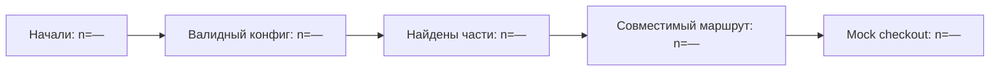

# Отчёт о прототипе «О!дин запрос»

> Шаблон для заполнения после интеграции этапов команды. Не оставляйте примерные числа в итоговом отчёте: измерения должны содержать дату, сборку, набор запросов и ссылку на evidence. Текущие данные провайдеров и тестовые сценарии описаны отдельно в [отчёте по провайдерам](REPORT.ru.md) и [матрице сценариев](TEST_SCENARIOS.ru.md).

## 1. Паспорт

| Поле | Заполнить |
|---|---|
| Проект / команда | godnota · Ostrovok Hackathon 2026 · «О!дин запрос» |
| Версия / commit SHA | |
| Есть ли незакоммиченные изменения; ссылка на сохранённый diff/сборку | |
| Дата и часовой пояс прогона | |
| Сборка / команда запуска | |
| Авторы и зоны ответственности | |
| Ссылка на демо / видео | |

**Состояние веток на дату отчёта:** [например `frontend` и `providers-api` отдельно; указать merge commit после интеграции]

## 2. Краткое описание

**Проблема путешественника:** [1–2 предложения]

**Что делает прототип:** [от первого запроса до какой именно точки]

**Кому и какую пользу даёт:** [путешественнику / Островку / отелю]

**Что показано на демо:** [включая mock-сегменты и известные ограничения]

### Покрытие ТЗ трека

Заполните по фактической интегрированной сборке. `Реализовано` означает, что можно повторить шаг в этой сборке; отдельный макет экрана или JSON-контракт без работающего перехода отмечайте как `частично`.

| Требование ТЗ | Статус: реализовано / частично / нет | Доказательство и ID сценария | Ограничение |
|---|---|---|---|
| Свободный запрос, выделение явных и скрытых требований | | U01–U08, U50–U58 | |
| Только критичные уточнения, редактирование ответов | | U04–U06, U52–U55 | |
| Вдохновение и выбор направления | | U02–U03, U56 | |
| Подбор отеля, авиа/ЖД, трансфера и досуга | | U16–U20, U59–U68 | |
| Сравнение по цене, времени, питанию, отмене, локации | | U21, U67 | |
| Причина выбора, компромисс и риск каждого варианта | | U21, U71 | |
| Сборка совместимого маршрута и полной корзины | | U11, U22–U23, U69–U72 | |
| Изменение условий без потери контекста | | U24–U26, U52–U53 | |
| Имитация бронирования, оплаты и отмены | | U27–U32, U73–U74 | |
| Неизвестный заранее запрос жюри | | U40 | |
| Мобильная версия или мессенджер | | U77; указать устройство/экран | |
| Опционально: память и персонализация | | U37 | |
| Опционально: помощь после покупки | | U75 | |

### Поставленные конфиги и API

| Результат задачи провайдеров | Путь/ссылка и версия | Проверка | Чего ещё нет |
|---|---|---|---|
| Один `TripRequest` для AI с обязательными полями | | схема, пример, валидатор | |
| Конфиг каждой ручки и реестр `provider → endpoint` | | число схем/примеров, совпадение с кодом | |
| Ограничения форматов, диапазонов, дат, валют | | отрицательные примеры и ошибки | |
| Документация REST: путь, метод, auth, запрос, ответ, ошибка | | дата последнего live-запроса | |
| Преобразование TripRequest в запросы провайдеров | | U59–U60 | |
| Поиск и нормализация ответа, отели и досуг при пересадках | | U61–U68 | |

Укажите отдельно, использован ли реальный API отелей. В текущей ветке гостиничный mock удалён; без доступа к ETG / RateHawk не показывайте отель как найденный. При отсутствии цены у расписания укажите `неизвестно`, а не `0 ₽`.

## 3. Реализованный путь

Опишите фактический пользовательский путь и укажите, где действует модель, детерминированный код, внешний API, кэш или синтетическая генерация.

| Этап | Реализовано | Подтверждение (ссылка/кадр/лог) | Ограничения |
|---|---|---|---|
| Понимание запроса и минимальные уточнения | | | |
| Вдохновение и выбор направления | | | |
| Поиск и сравнение поездки | | | |
| Объяснение причин, компромиссов и рисков | | | |
| Проверка стыковок и полной стоимости | | | |
| Пересборка после изменения условий | | | |
| Корзина и имитация бронирования | | | |
| Память / помощь после покупки (если сделано) | | | |
| Авторизация и серверное хранение профиля/истории | | | |

Отдельно укажите для интерфейса: browser-only standalone, demo API или gateway API. Локальное сохранение в браузере не является серверной авторизацией или общей историей пользователя.

**Контракты на границах:** [версии `TripRequest`, JSON Schema и protobuf; совместимость frontend ↔ gateway, AI ↔ travel, provider ↔ route; дата проверки; открытые несовместимости].

## 4. Данные и ограничения

| Данные | Источник | Метка в интерфейсе | Свежесть / ограничение |
|---|---|---|---|
| География и достопримечательности | | real / cached / synthetic | |
| Расписание и цена транспорта | | real / cached / synthetic | |
| Отель и тариф | | real / cached / synthetic | |
| Погода / температура моря | | real / cached / synthetic | |
| Трансфер | | real / cached / synthetic | |
| Отзывы | | real / synthetic | |

Укажите лицензии/атрибуцию, ограничения бесплатных API, поведение при недоступности и факты, которые нельзя проверить в прототипе. Не называйте синтетические цены/отзывы рыночными или пользовательскими.

Разделяйте **способ получения** (`живой HTTP-ответ`, локальная фикстура, mock) и **свежесть исходного факта** (актуальное наличие, кэшированная цена, неизвестно). Ответ 200 от API может содержать кэшированную цену; он не подтверждает наличие места или конечный тариф.

**Безопасность и происхождение данных:** [секреты вне Git и браузера; серверная авторизация и проверка владельца сессии/заказа; маскировка логов; безопасный вывод внешнего текста; время получения ответа и допустимый срок кэша]. Для каждого пункта укажите факт проверки или открытый риск.

## 5. Методика проверки

| Параметр | Значение |
|---|---|
| Сборка / commit SHA | |
| Статус рабочей копии и версия конфигов/фикстур | |
| Среда и устройство | |
| Набор сценариев и версия | [см. `docs/TEST_SCENARIOS.ru.md`] |
| Число попыток / уникальных запросов | |
| Кто запускал и кто оценивал | |
| Правила pass/fail и обработка заблокированных случаев | |
| Evidence (логи, видео, скриншоты) | |

Набор запросов закрепите до прогона: простые, размытые, противоречивые, многогородские, разные виды транспорта, сбои и неожиданные для команды запросы. Сохраните сырые входы и эталонные жёсткие ограничения; оценщик не должен менять критерии после просмотра ответа модели. Прогоны в demo и API режимах считайте отдельно. Для времени запускайте одинаковый таймер от отправки первого сообщения, повторяйте сценарий несколько раз и записывайте каждый результат, включая ошибки.

### Сводка сценариев

| Состояние | Количество |
|---|---:|
| Пройдено | |
| Не пройдено | |
| Заблокировано / не реализовано | |
| Не запускалось | |

**Доля завершённых:** `успешно завершённые сценарии / все начатые сценарии` = [не вычислено]. Покажите отдельно долю среди технически доступных сценариев; в основной доле заблокированные случаи остаются в знаменателе. Разделяйте `не запускался` и `заблокирован`, чтобы низкая полнота продукта не скрылась исключениями.

## 6. Метрики качества

| Метрика | Определение | Результат | Знаменатель / p50/p95 | Evidence |
|---|---|---:|---|---|
| Доля завершения пути | Дошёл до mock checkout без критической ошибки / все начатые сценарии | | число завершённых и начатых; отдельно demo/API | |
| Соблюдение hard constraints | Проверенные финальные маршруты без нарушений хотя бы одного жёсткого ограничения / все проверенные финальные маршруты с такими ограничениями | | числитель/знаменатель; целевое значение 100% | |
| Ошибки стыковок | Число несовместимых маршрутов в финальном плане; целевое значение 0 | | | |
| Уточнения | Число вопросов агента до первой полезной рекомендации | | p50 / p95 | |
| Время до первой рекомендации | От первого сообщения до первой проверяемой рекомендации | | p50 / p95, секунды | |
| Восстановление провайдера | Ошибки, после которых показан полезный fallback / инъецированные или наблюдённые ошибки | | | |
| Ошибки цены при пересборке | Случаи, где новая сумма не показана до подтверждения | | целевое значение 0 | |
| Дубли брони | Повторные заказы на один пользовательский intent при retry/double click | | целевое значение 0 | |
| Прозрачность предложений | Предложения с видимым источником, временем и меткой `real/cached/synthetic` / все показанные предложения | | числитель/знаменатель | |
| Валидность AI-конфига | Ответы AI, прошедшие схему и кросс-полевую проверку без ручного исправления / все ответы AI | | число валидных и всех ответов | |
| Покрытие поставщиков | Сценарии, где получены требуемые сегменты с известным происхождением / все сценарии поиска | | по авиа, ЖД, воде, отелям, досугу | |
| Точность итоговой цены | Корзины, где сумма совпадает с суммой подтверждённых компонентов в одной валюте / все рассчитанные корзины | | разница в minor units; целевое значение 0 | |
| Удовлетворённость после задачи | Ответ пользователя по шкале и свободный комментарий после реального теста | | n и метод сбора | |

Для времени используйте один и тот же таймер и считайте первую рекомендацию полезной, только если в ней есть конкретный вариант и подтверждаемое основание. Для нескольких запусков показывайте медиану и p95, а не лучший единичный результат.

**Бизнес-гипотезы из ТЗ:** сокращение пути от идеи до выбора можно оценить сравнением времени и доли завершения на одинаковых заданиях с обычным поиском; снижение отказов — долей пользователей, бросивших задачу до сравнения; пользу отелю — долей рекомендаций, подтверждённо соблюдающих требования гостя. Фактическую конверсию в покупку, средний чек, возвращаемость и отмены нельзя выводить из mock checkout. Если нет контрольной группы или реальных заказов, оставьте эти поля как гипотезы без результата.

### Визуализации для защиты

После реальных прогонов постройте 3 небольших вида. Воронка показывает число дошедших до этапов «запрос → валидный конфиг → найденные части → совместимый маршрут → mock checkout», включая причины отсева. Диаграмма для базового сценария и правки условий показывает число вопросов, время до первой рекомендации и изменение полной цены. Временная линия одного маршрута показывает местные даты, пересадки, заселение, трансфер, запас времени и источник каждого сегмента. Подпишите версию, режим, размер выборки и происхождение данных. При нулевом числе реальных прогонов оставьте оси без значений.



В итоговой версии к каждому переходу добавьте число и причину неуспеха: недостающие поля, ошибка поставщика, несовместимая стыковка, отказ пользователя или дефект. Плейсхолдеры выше не являются результатом эксперимента.

```text
Сценарии:          U01  U02  U17  U24  U40
Завершение, %:      —    —    —    —    —
Уточнения, шт.:     —    —    —    —    —
Время, сек.:        —    —    —    —    —
Ошибки стыковки:    —    —    —    —    —
```

Пока данных нет, оставьте плейсхолдеры. Не вставляйте придуманный график как свидетельство качества.

## 7. Тесты и демонстрационные случаи

| Проверка | Команда / сценарий | Результат | Evidence |
|---|---|---|---|
| Unit/integration tests | | | |
| Статический анализ | | | |
| Сквозной позитивный сценарий | | | |
| Ошибки API / пустые ответы | | | |
| Повтор бронирования / stale price | | | |
| Пересборка плана | | | |

Покажите один основной путь, один изменённый запрос и одно корректное восстановление после ошибки. Ясно маркируйте имитацию оплаты и синтетические данные.

## 8. Опрос и обратная связь

### Реальные участники

| Код участника (без имени) | Задача | Удалось завершить? | Понятность плана (1–5) | Доверие к объяснениям (1–5) | Что мешало / цитата с согласием |
|---|---|---:|---:|---:|---|
| | | | | | |

Укажите `n`, способ набора, дату, формулировку вопросов, добровольность и согласие на публикацию цитаты. Не собирайте ненужные персональные данные.

Одинаковые вопросы после одной и той же задачи: «Удалось ли завершить планирование?», «Сколько усилий потребовали уточнения?» (1 — очень много, 5 — почти не потребовали), «Понятно ли, почему предложен этот вариант?» (1–5), «Понятно ли, какие цены и данные тестовые?» (1–5), «Что вы изменили бы перед бронированием?» (свободный ответ). Записывайте точную формулировку, а не пересказ. Не выводите среднюю оценку при `n=0`; при малом `n` показывайте распределение ответов и цитаты только с согласием.

### Синтетические прогоны (опционально)

Используйте только для нагрузочного/сценарного тестирования и подписывайте `синтетический пользователь/диалог`. Такие ответы не являются опросом, отзывами реальных людей или доказательством удовлетворённости.

## 9. Риски, дефекты и следующие шаги

| Приоритет | Риск / дефект | Влияние на пользователя | Обходной путь | Владелец | Следующий шаг |
|---|---|---|---|---|---|
| | | | | | |

## 10. Итог

**Что подтверждено:** [только результаты с evidence]

**Что не подтверждено / не реализовано:** [явный список]

**Главный следующий шаг:** [конкретное действие и ответственный]
